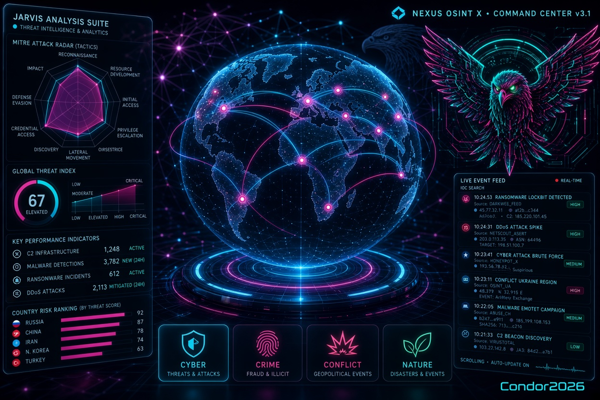

# Nexus_Osint_X · Command Center v3.1



[](https://www.python.org/)
[](https://fastapi.tiangolo.com/)
[](https://www.uvicorn.org/)
[](https://www.sqlite.org/)
[](https://deck.gl/)
[](https://www.chartjs.org/)
[](https://jinja.palletsprojects.com/)
[](https://developer.mozilla.org/en-US/docs/Web/API/WebSockets_API)
[](https://jwt.io/)
[](https://platform.openai.com/)
[](https://attack.mitre.org/)
[](https://en.wikipedia.org/wiki/Open-source_intelligence)
[](https://en.wikipedia.org/wiki/Cyber_threat_intelligence)
[](https://github.com/Condor2026/Nexus_Osint_X)
[](https://github.com/Condor2026/Nexus_Osint_X)
[](./LICENSE)
[](https://github.com/Condor2026/Nexus_Osint_X)
[](https://github.com/Condor2026/Nexus_Osint_X/commits/main)
[](https://github.com/Condor2026/Nexus_Osint_X)
[](https://github.com/Condor2026/Nexus_Osint_X/stargazers)
[](https://github.com/Condor2026/Nexus_Osint_X/issues)
[](https://github.com/Condor2026/Nexus_Osint_X/pulls)


> Radar OSINT autohospedado: 110+ fuentes públicas, globo 3D con deck.gl, correlación entre dominios, MITRE ATT&CK, panel JARVIS y bot de Telegram. Todo en un único `nexus.py` ejecutable con `uvicorn`.


---

## ⚠️ Descargo de responsabilidad

- Todos los indicadores (IPs, dominios, hashes) provienen de **fuentes públicas**: CERTs oficiales (GovCERT.ch, CISA), prensa, canales públicos de Telegram, APIs públicas (abuse.ch, Cloudflare Radar, FBI, INTERPOL).
- **Sin verificación independiente.** La atribución a grupos es lo que dicen las fuentes públicas, no una conclusión forense.
- **Uso permitido:** investigación defensiva, threat intelligence, educación, SOC.
- **Uso prohibido:** ataques activos, escaneos no autorizados, acciones legales basadas en estos datos, acoso a personas.
- Los nombres de grupos son **públicos y documentados** por CERTs y prensa (Killnet, NoName057(16), Lazarus, APT28…). No son acusaciones privadas.
- Si eres titular de una IP listada y crees que es un error, abre un issue y se revisa.

### Lo que Nexus_Osint_X NO hace

- ❌ No escanea puertos ni hosts.
- ❌ No explota vulnerabilidades.
- ❌ No contacta con C2 ni con infraestructura maliciosa.
- ❌ No envía tráfico a los indicadores que muestra (las URLs van defangeadas: `hxxp://ejemplo[.]com`).
- ❌ No simula ataques ni genera escenarios hipotéticos.
- ❌ No predice el futuro.
- ❌ No reemplaza a un SOC, un CTI o un analista humano.
- ❌ No verifica independientemente las atribuciones: refleja lo que dice la fuente.

**Nexus_Osint_X es un radar, no un simulador.** Si buscas un war-game o un generador de escenarios, esta no es tu herramienta.

---

## ✨ Qué hace

- **110+ fuentes OSINT** integradas en **Nexus_Osint_X**: ciberataques (DDoS, malware/botnets, fuerza bruta, exploits, ransomware, phishing), MITRE ATT&CK, cibercrimen, crimen mundial/urbano, conflictos, disturbios, naturaleza, salud, economía, sanciones, **FBI Wanted e INTERPOL Red Notices**.
- **Globo 3D y plano** con `deck.gl` en la propia página (sin iframe) + red neuronal animada de fondo.
- **Arcos reales** atacante→víctima solo cuando ambos extremos son conocidos (Cloudflare Radar, noticias atribuidas, feeds de grupos). Sin dos extremos, no hay arco.
- **Modos temáticos** (ciber / crimen / conflicto / naturaleza / economía / prensa), ranking de riesgo por país y buscador de IOC.
- **SQLite** con histórico, clustering espacial y retención automática (`NEXUS_RETENTION_DAYS`, 120 días por defecto).
- **Correlación** con scoring ponderado, decaimiento temporal y entidades compartidas.
- **Detección de anomalías**: z-score por dominio, entidades nuevas, ráfagas CRÍTICA, sentimiento negativo.
- **Enriquecimiento**: dedupe semántico (SimHash), escalado de severidad, watchlist persistente, tendencias por dominio, búsqueda facetada.
- **Auth** JWT + HTTP Basic + bypass de loopback (`NEXUS_LOCAL_NOAUTH=1` por defecto, solo desde 127.0.0.1 sin proxy).
- **Circuit breaker** por fuente: 5 fallos seguidos → pausada 5 min.
- **WebSocket** para actualizaciones en vivo.
- **Export** en 12 formatos: CSV, JSON, NDJSON, GeoJSON, KML, XLSX, Markdown, HTML, lista de IPs, IPs de grupos (CSV/JSON), ZIP.
- **Bot de Telegram** con 13 comandos e inline keyboards.
- **LLM opcional** con 3 prompts y caché (si defines `OPENAI_API_KEY`).
- **Scheduler** con health monitoring por fuente y retención automática.

---

## 🚀 Arranque rápido

### 1. Requisitos

- Python **3.11+**
- (Opcional) `GeoLite2-City.mmdb` de MaxMind para geolocalización local. Sin él se usa `ip-api.com/batch` (límite 15 req/min).

### 2. Instalar y configurar

```bash
git clone https://github.com/Condor2026/Nexus_Osint_X
cd Nexus_Osint_X

python -m venv .venv
source .venv/bin/activate          # Windows: .venv\Scripts\activate
pip install -r requirements.txt

cp .env.example .env
# Edita .env: como mínimo cambia ADMIN_PASSWORD y genera JWT_SECRET
```

Genera un `JWT_SECRET` fuerte:

```bash
python -c "import secrets; print(secrets.token_hex(32))"
```

### 3. Ejecutar

```bash
python nexus.py
# → http://127.0.0.1:8000
```

El primer barrido arranca solo en segundo plano. La BD (`nexus.db`) se crea en el primer arranque y se migra automáticamente si ya existía de una versión anterior.

---

## 🔑 Fuentes y claves

Todas las claves son **opcionales**: sin ellas, la fuente simplemente devuelve 0 eventos y el resto del sistema sigue funcionando.

| Fuente | Clave necesaria | Dónde obtenerla |
|---|---|---|
| URLhaus, ThreatFox, MalwareBazaar | `ABUSECH_AUTH_KEY` | https://auth.abuse.ch/ (gratis) |
| Cloudflare Radar (DDoS) | `CLOUDFLARE_API_TOKEN` | https://dash.cloudflare.com/profile/api-tokens (permiso Radar) |
| NASA FIRMS | `NASA_FIRMS_MAP_KEY` | https://firms.modaps.eosdis.nasa.gov/api/ |
| OpenSky | `OPENSKY_USER` / `OPENSKY_PASS` | https://opensky-network.org/ |
| FRED | `FRED_API_KEY` | https://fredaccount.stlouisfed.org/apikeys |
| EIA | `EIA_API_KEY` | https://www.eia.gov/opendata/ |
| ACLED | `ACLED_EMAIL` / `ACLED_PASSWORD` | https://developer.acleddata.com/ |
| AISStream | `AISSTREAM_API_KEY` | https://aisstream.io/ |
| ADS-B Exchange | `ADSB_API_KEY` | https://www.adsbexchange.com/ |
| ReliefWeb | `RELIEFWEB_APPNAME` | https://apidoc.reliefweb.int/ |
| OpenSanctions | `OPENSANCTIONS_API_KEY` | https://www.opensanctions.org/api/ |
| Ransomware.live | `RANSOMWARE_LIVE_KEY` | https://www.ransomware.live/ |
| Telegram | `TELEGRAM_BOT_TOKEN` / `TELEGRAM_CHAT_ID` | @BotFather · @userinfobot |
| LLM | `OPENAI_API_KEY` | https://platform.openai.com/api-keys |

Las fuentes sin clave (Feodo, CISA KEV, SANS ISC, Blocklist.de, ET Compromised, Spamhaus DROP, SSLBL, OpenPhish, RSS de seguridad, GDELT, USGS, EONET, NOAA, WHO, OFAC, FBI Wanted, INTERPOL Red Notices, portales de crimen urbano, etc.) funcionan **desde el primer minuto**.

---

## 🗺️ Qué significa cada cosa en el mapa

### Puntos
Cada punto es **un evento real** con `source`, `url` y `timestamp` verificables.
- **Tamaño**: severidad + relevancia (CRÍTICA > ALTA > MEDIA > BAJA).
- **Color**: dominio del evento (ver leyenda abajo a la izquierda; clic para filtrar).
- **Halo magenta**: evento CRÍTICA (se dibuja aparte para que no se pierda).
- **Clic en un punto**: abre ficha con fuente, título, descripción, enlace original y coordenadas.

### Arcos (solo ciberataques)
Los arcos **NO son simulaciones ni predicciones**. Solo se dibujan cuando **origen y víctima son conocidos**:
- **Cloudflare Radar** mide pares reales `origen → objetivo` de DDoS (capa 3 y 7).
- **Noticias/avisos de ciberseguridad** que atribuyen un ataque a un país/grupo **y** nombran a la víctima (p. ej. *"hackers rusos atacan hospitales de Ucrania"*).
- **Feeds de IPs de grupos** cuando la fuente dice a quién atacó (CERT suizo: IP → Suiza).

Si no hay dos extremos conocidos, **no hay arco**. Una IP maliciosa suelta no tiene víctima: no dibuja nada.

El selector **"Solo flujos reales"** (por defecto) garantiza que solo ves arcos con dato real. Si eliges otro destino, los arcos adicionales son **ilustrativos** (tú eliges el punto), y la interfaz lo indica.

### Correlaciones (círculos magenta)
Agrupaciones de eventos de **dominios distintos** que coinciden en espacio (<5°) y tiempo (<60 min), con entidades compartidas. El `score` se muestra en el tooltip. No son predicciones: son **coincidencias observadas**.

### IPs de grupos (cuadrados)
IPs atribuidas a grupos (Killnet, NoName057(16)…) por **feeds públicos** (GovCERT.ch, SecurityScorecard) o **canales públicos de Telegram**. El registro es **permanente** (no depende de la ventana de tiempo), pero las IPs caducan a los `NEXUS_GROUP_IP_KEEP_DAYS` días si no se vuelven a ver.
- **Verde/brillante**: vista en vivo en las últimas `NEXUS_GROUP_FRESH_HOURS` horas.
- **Atenuada**: lista histórica (marcar "+históricas" en la toolbar).
- **Borde blanco discontinuo**: IP "reportada" (no verificada, puede ser víctima).

### Lo que NO se dibuja
- Eventos sin país/ciudad reconocible en el texto → se descartan (no se inventan coordenadas).
- Conflictos, crimen, naturaleza → **no dibujan arcos** (solo ciberataques).
- Escenarios hipotéticos, predicciones, "qué pasaría si" → **no existen en Nexus_Osint_X**.

---

## 🧭 Filosofía: radar, no simulador

Nexus_Osint_X es **OSINT: observación de lo que pasa**, no planificación de lo que podría pasar.

**Lo que Nexus_Osint_X hace:**
- Muestra eventos **reales** con fuente, URL y timestamp.
- Correlaciona **lo que ocurrió** (proximidad espacial + temporal + entidades).
- Alerta de **lo que está pasando** (C2 nuevos, DDoS, anomalías).
- Traza **flujos reales** atacante→víctima solo cuando ambos extremos son conocidos.

**Lo que Nexus_Osint_X deliberadamente NO hace:**
- ❌ No simula cadenas de ataque hipotéticas.
- ❌ No genera escenarios "qué pasaría si" con LLM.
- ❌ No pinta predicciones como si fueran hechos.
- ❌ No reemplaza el juicio del analista con ficción plausible.

**Por qué:** en OSINT, **un dato real con fuente vale más que cien escenarios generados**. Mezclar ficción con señal real convierte el radar en un generador de rumores. Si quieres un simulador de red team, Nexus_Osint_X no es tu herramienta.

**Trazabilidad:** cada punto del mapa tiene `source`, `url`, `timestamp` y `raw_hash` (SHA256). Si no se puede verificar, no se muestra.

---

## 📐 Cómo se puntúa

### Severidad de un evento
Cada colector sugiere una severidad base. Luego `assess_severity()` la ajusta:
- **Tipo de dominio**: ransomware +2.5, exploit +2.0, DDoS +1.5, phishing +1.0, fuerza bruta 0.0…
- **Infraestructura crítica afectada** (hospital, energía, gobierno, banca…): +1.5.
- **Escala** (récord, Tbps, millones, nacional…): +1.0.
- **Explotación activa** (0-day, actively exploited, KEV): +1.0.
- **Actor/familia conocida** (LockBit, APT28, Killnet…): +1.0.
- **Vulnerabilidad con ransomware conocido**: +1.5.

Resultado: `CRITICA` (≥4.5) · `ALTA` (≥3.0) · `MEDIA` (≥1.8) · `BAJA` (<1.8).

### Correlación entre eventos
`compute_correlations()` combina:
- **Peso de dominio** (`WEIGHTS`: ciberataque=3, conflicto=3, terremoto=2…).
- **Proximidad espacial** (distancia <5°).
- **Decaimiento temporal** (ventana de 60 min).
- **Entidades compartidas** (bonus hasta +1.0).
- **Score final** = peso × (1+3×proximidad) × (0.5+0.5×temporal) × (1+bonus).

Solo se guardan correlaciones con `score ≥ 5`.

### Índice de amenaza (JARVIS)
`100 × (1 − exp(−carga_ponderada/hora / 80))`. Saturación suave: 0 = calma, 100 = saturación. Se compara siempre contra la **ventana anterior de igual tamaño**.

---

## 🗺️ Uso del dashboard

| Atajo | Acción |
|---|---|
| `/` | Enfocar el buscador |
| `r` | Refrescar datos |
| `j` | Abrir/cerrar el panel JARVIS |
| `+` / `-` | Acercar / alejar |
| `0` | Restablecer vista |
| `n` | Siguiente alerta crítica/alta |
| `c` | Mostrar/ocultar ciudades |
| `Esc` | Cerrar JARVIS |

- **Clic en un evento del feed** → centra el mapa en su ubicación.
- **Clic en una leyenda de dominio** → filtra por ese dominio.
- **Clic en un país (pestaña Países)** → filtra y centra.
- **Pestaña IOC** → pega IP/dominio/hash/CVE (acepta formato _defangeado_ `hxxp://ejemplo[.]com`) y obtiene coincidencias en la BD + enlaces a VirusTotal, AbuseIPDB, Shodan, urlscan, NVD…

---

## 🧠 Panel JARVIS

Overlay de análisis global (`j` o botón **JARVIS**) con:

- **Índice de amenaza** 0-100 con comparación vs. ventana previa.
- **KPIs**: C2/botnets, malware, DDoS, fuerza bruta, exploits/0-day, ransomware, phishing, vulnerabilidades KEV, IPs únicas, crimen, conflicto, críticos.
- **Tácticas MITRE ATT&CK** en radar polar.
- **Línea temporal** por familia de dominios (24 cubos).
- **Top países** por riesgo ponderado.
- **Fuentes más activas** y **alertas recientes**.
- **Técnicas ATT&CK** con clic para filtrar el mapa.
- **Qué ha cambiado** vs. ventana anterior, **corredores de ciberataque** reales y **grupos activos**.

---

## 🔌 API

| Método | Ruta | Descripción |
|---|---|---|
| `GET` | `/api/kpis` | Contadores de la ventana actual |
| `GET` | `/api/map` | GeoJSON compacto para deck.gl |
| `GET` | `/api/events` | Eventos filtrables |
| `GET` | `/api/correlations` | Correlaciones por score |
| `GET` | `/api/anomalies` | Anomalías |
| `GET` | `/api/stats` | Estadísticas globales |
| `GET` | `/api/search` | Búsqueda facetada |
| `GET` | `/api/entities` | Top entidades |
| `GET` | `/api/trends` | Tendencias por dominio |
| `GET` | `/api/countries` | Ranking de riesgo por país |
| `GET` | `/api/ioc` | Clasificar y buscar IOC |
| `GET` | `/api/attack` | Técnicas ATT&CK más vistas |
| `GET` | `/api/analytics` | Datos completos del panel JARVIS |
| `GET` | `/api/health` | Estado de fuentes y circuit breakers |
| `GET` | `/api/sweep/status` | Estado del barrido |
| `POST` | `/api/sweep/start` | Lanzar barrido en segundo plano |
| `POST` | `/api/circuit/reset` | Reiniciar circuit breakers |
| `GET` | `/api/watchlist` | Ver watchlist |
| `POST` | `/api/watchlist/add` | Añadir a watchlist |
| `POST` | `/api/watchlist/remove` | Quitar de watchlist |
| `POST` | `/api/token` | JWT (form: `username`, `password`) |
| `GET` | `/api/group_ips` | IPs atribuidas a grupos |
| `GET` | `/api/threat_groups` | Grupos activos |
| `GET` | `/api/groups` | Modos temáticos y dominios |
| `GET` | `/api/detector` | Detecciones del detector de denuncias |
| `POST` | `/api/detector/scan` | Lanzar escaneo de canales + feeds |
| `GET` | `/export/{fmt}` | Exportaciones (12 formatos) |
| `WS` | `/ws` | Actualizaciones en vivo |

Auth: `Authorization: Bearer <jwt>` o HTTP Basic. Desde `127.0.0.1` sin proxy el dashboard no pide login (`NEXUS_LOCAL_NOAUTH=1`).

---
## 🤖 Bot de Telegram (experimental)

> ⚠️ **En pruebas.** Los comandos funcionan, pero el bot puede cambiar entre versiones. No lo uses como único canal de alertas en producción.

Comandos previstos: `/start`, `/help`, `/brief`, `/sweep`, `/stats`, `/top`, `/health`, `/anomalies`, `/export`, `/search <q>`, `/domains`, `/trends`, `/watch`.

Requiere `TELEGRAM_BOT_TOKEN` y `TELEGRAM_CHAT_ID` en `.env`. Sin ellos, el bot simplemente no arranca (el resto del sistema sigue funcionando).


---

## 🧱 Arquitectura

```
nexus.py
├── §0   Configuración + caché + circuit breaker
├── §1   Auth (JWT + Basic + bypass loopback)
├── §2   Caché TTL + breaker
├── §3   SQLite (schema, migración, queries, retención)
├── §4   Geolocalización multi-proveedor (GeoLite2 → ip-api batch → geojs)
├── §5   Texto: sentimiento, países, entidades, tags
├── §5b  Enriquecimiento: dedupe SimHash, severidad, watchlist, tendencias
├── §6   Colectores (110+ fuentes, cada una degrada sola)
├── §7   Correlación (clustering espacial + decaimiento + entidades)
├── §8   Anomalías (z-score + avanzadas)
├── §9   LLM (3 prompts + caché)
├── §10  Telegram + alertas
├── §11  Exportación
├── §12  Orquestación de barrido
├── §13  Payload del mapa (JSON compacto)
├── §14  Frontend (HTML/CSS/JS + NeuralNet + deck.gl + JARVIS)
└── §15  FastAPI (rutas, parciales, API, WebSocket)
```

**Decisiones de diseño**

- **El mapa no se genera con pydeck en iframe.** El servidor entrega JSON compacto (`/api/map`) y el navegador mantiene _una sola_ instancia de deck.gl; cambiar filtros no recrea WebGL.
- **Fuentes que degradan solas.** Cada colector puede lanzar excepciones: `run_source()` las captura, registra y alimenta el circuit breaker. Sin clave → `[]`.
- **Migración automática de la BD.** Si la tabla `events` no tiene `entities`/`tags`, se añaden con `ALTER TABLE` al arrancar.
- **Ubicación honesta.** Si un texto no menciona país, el evento se descarta (no se inventan coordenadas). Los centroides se _jitterizan_ de forma determinista para que 40 noticias del mismo país no se apilen.

---

## 🩺 Solución de problemas

| Síntoma | Causa probable | Solución |
|---|---|---|
| El mapa sale vacío | No hay eventos en la ventana o el barrido no ha corrido | Pulsa **⚡ Barrido** o amplía la ventana a 24h/7d |
| "Mapa 2D de reserva" | WebGL deshabilitado o deck.gl no cargó desde CDN | Activa WebGL o sirve deck.gl localmente (`NEXUS_DECK_URL`) |
| Una fuente da 0 eventos | Falta API key o no se pudo geolocalizar | Revisa `.env` y la pestaña **🩺 Fuentes** (🔑 = falta clave) |
| "circuit open" en una fuente | 5 fallos seguidos → pausada 5 min | **🔌 Reiniciar circuit breakers** en la pestaña Fuentes |
| El bot de Telegram no responde | Falta `TELEGRAM_BOT_TOKEN` o `TELEGRAM_CHAT_ID` | Configúralos en `.env` y reinicia |
| Error de migración de BD | BD creada con versión anterior | Se migra sola al arrancar; si falla, borra `nexus.db` y reinicia (pierdes histórico) |
| Puerto 8000 ocupado | Instancia anterior no cerrada | Nexus_Osint_X usa el siguiente libre (8001, 8002…) y lo dice en el log |
| `sqlite3.IntegrityError` en eventos | Duplicado por `raw_hash` (normal) | Se ignora silenciosamente; no es un error |
| La geolocalización va lenta | `ip-api.com` limita a 15 req/min | Sin `GeoLite2-City.mmdb` es normal; añade el `.mmdb` para ir local |

---

## 📁 Estructura del repo

```
.
├── nexus.py                 # Aplicación completa
├── requirements.txt
├── .env.example
├── .gitignore
├── LICENSE
├── README.md
├── CONTRIBUTING.md
├── SECURITY.md
└── (opcional) GeoLite2-City.mmdb   # NO se sube: añádelo a mano
```

---

## ⚠️ Aviso legal y uso responsable

Nexus_Osint_X agrega **fuentes públicas** (feeds de seguridad, agencias gubernamentales, prensa, APIs abiertas). No realiza escaneos activos, no visita URLs de phishing (solo resuelve DNS), no interactúa con infraestructura maliciosa.

Úsalo solo para **investigación defensiva, monitorización de amenazas o docencia**, cumpliendo las leyes de tu jurisdicción y los términos de cada API. El autor no se responsabiliza del uso indebido.

Los indicadores (IPs, hashes, URLs) se muestran _defangeados_ (`hxxp://ejemplo[.]com`) para evitar clics accidentales.

---

## 🙏 Créditos

Nexus_Osint_X no sería posible sin el trabajo público de estas organizaciones y proyectos. Todo el mérito de los datos es suyo; los errores de integración son míos.

### Agencias gubernamentales y CERTs
- **FBI** — [Wanted API](https://www.fbi.gov/wanted/api) y [National Press Releases RSS](https://www.fbi.gov/feeds/national-press-releases/rss.xml)
- **INTERPOL** — [Red Notices API pública](https://ws-public.interpol.int/notices/v1/red)
- **CISA** — [Known Exploited Vulnerabilities (KEV)](https://www.cisa.gov/known-exploited-vulnerabilities-catalog) y [Cybersecurity Advisories](https://www.cisa.gov/cybersecurity-advisories)
- **GovCERT.ch** (CERT Suiza) — [IPs y CIDR de NoName057(16)](https://github.com/govcert-ch/CTI)
- **US Department of State** — [Travel Advisories RSS](https://travel.state.gov/_res/rss/TAsTWs.xml)
- **US Treasury / OFAC** — [SDN List](https://sanctionslistservice.ofac.treas.gov/)
- **UN Security Council** — [Consolidated Sanctions List](https://main.un.org/securitycouncil/en/content/un-sc-consolidated-list)
- **USGS** — [Earthquake API](https://earthquake.usgs.gov/fdsnws/event/1/)
- **NASA** — [EONET](https://eonet.gsfc.nasa.gov/) y [FIRMS](https://firms.modaps.eosdis.nasa.gov/)
- **NOAA** — [Active Weather Alerts](https://api.weather.gov/alerts/active)
- **WHO** — [Disease Outbreak News](https://www.who.int/api/news/diseaseoutbreaknews)
- **ReliefWeb (OCHA)** — [Reports API](https://apidoc.reliefweb.int/)
- **ACLED** — [Armed Conflict Location & Event Data](https://acleddata.com/)
- **FRED (St. Louis Fed)** — [Series API](https://fred.stlouisfed.org/)
- **BLS** — [Public Data API](https://www.bls.gov/developers/)
- **EIA** — [Open Data API](https://www.eia.gov/opendata/)

### Threat intelligence y seguridad
- **abuse.ch** — [Feodo Tracker](https://feodotracker.abuse.ch/), [URLhaus](https://urlhaus.abuse.ch/), [ThreatFox](https://threatfox.abuse.ch/), [SSLBL](https://sslbl.abuse.ch/), [MalwareBazaar](https://bazaar.abuse.ch/)
- **Spamhaus** — [DROP list](https://www.spamhaus.org/drop/)
- **SANS ISC** — [DShield API](https://isc.sans.edu/api/)
- **Blocklist.de** — [API](https://www.blocklist.de/)
- **Emerging Threats** — [Compromised IPs](https://rules.emergingthreats.net/blockrules/compromised-ips.txt)
- **CI Army**, **GreenSnow**, **Binary Defense** — listas de IPs atacantes
- **OpenPhish** — [Public feed](https://openphish.com/)
- **Ransomware.live** y **RansomLook** — [API pública](https://www.ransomware.live/), [RansomLook](https://www.ransomlook.io/)
- **Cloudflare Radar** — [Security & Attacks](https://radar.cloudflare.com/security-and-attacks)
- **SecurityScorecard** — [KillNet DDoS Blocklist](https://github.com/securityscorecard/SSC-Threat-Intel-IoCs)
- **MITRE ATT&CK** — [Framework](https://attack.mitre.org/)
- **OpenSanctions** — [API](https://www.opensanctions.org/api/)

### Datos abiertos de crimen urbano
- **Chicago Police Department** — [Open Data Portal](https://data.cityofchicago.org/)
- **NYPD** — [NYC Open Data](https://data.cityofnewyork.us/)
- **San Francisco Police Department** — [SF Open Data](https://data.sfgov.org/)
- **Los Angeles Police Department** — [LA Open Data](https://data.lacity.org/)

### Medios y prensa
- BBC, The Guardian, Al Jazeera, DW, France 24, RFI, NPR, NYT, CNN, Sky News, Euronews, ABC Australia, The Hindu, Japan Times, SCMP, UN News, El País, El Mundo, La Vanguardia, elDiario.es, 20minutos, Europa Press, El Correo, Deia, RTVE, Infobae, Le Monde, Le Figaro, Der Spiegel, Tagesschau, ANSA, La Repubblica, Clarín
- **GDELT Project** — [DOC y GEO APIs](https://www.gdeltproject.org/)
- **Wikipedia** — [Portal:Current events](https://en.wikipedia.org/wiki/Portal:Current_events)
- **InSight Crime**, **DOJ Press Releases**, **Krebs on Security**, **BleepingComputer**, **The Hacker News**, **The Record**, **SecurityWeek**, **DarkReading**, **Malwarebytes**

### Tecnología
- **deck.gl** — visualización 3D
- **FastAPI** + **Uvicorn** — backend
- **Natural Earth** — datos geográficos
- **Jinja2**, **Chart.js**, **httpx**, **feedparser**, **APScheduler**, **passlib**, **PyJWT**
- **OpenAI** — LLM opcional
- **Telegram Bot API**

### Agradecimiento especial
A **GovCERT.ch** por publicar abiertamente las IPs y rangos de NoName057(16), y a **SecurityScorecard** por la lista de proxies de Killnet. Sin su transparencia, este proyecto no tendría la capa de grupos que tiene.

Si eres responsable de una de estas fuentes y quieres que ajuste la atribución, abre un issue.

---

## 📄 Licencia

MIT — ver LICENSE.

**Condor2026**

